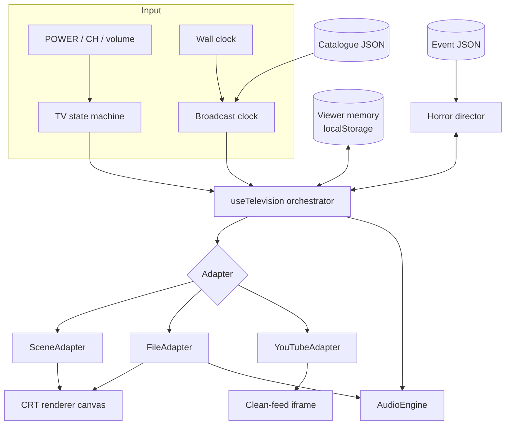
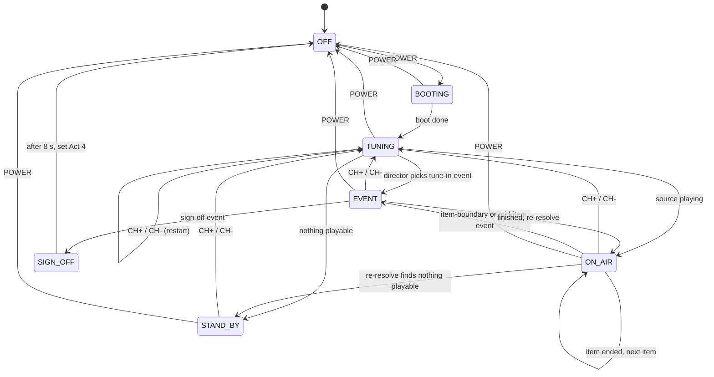

# Design: DEAD AIR Television

## 1. Overview

A static React application containing four cooperating systems:

1. **Broadcast clock:** decides what is on, from wall-clock time alone.
2. **Playback adapters:** present scene, file, and YouTube sources behind one interface.
3. **Horror director:** decides whether something should go wrong, from viewer memory.
4. **Television shell:** the state machine, CRT renderer, audio, and physical controls.

The key decision is that **the clock replaces NMTV's backend and queue**. NMTV fetches video blocks per channel and saves each channel's playback state on the client. We compute position from a fixed rundown, so there is no server, no sync bug, and no state to restore.



## 2. The YouTube constraint

YouTube's Required Minimum Functionality says that overlays, frames, or other visual elements must not appear in front of any part of an embedded player, and it cannot be modified beyond the documented API. A cross-origin iframe also cannot be sampled by WebGL. So **YouTube video cannot have CRT effects**, and the rendering is split:

| | Owned source (scene, file) | YouTube source |
|---|---|---|
| Surface | WebGL canvas | Iframe rectangle |
| Scanlines, curvature, bloom | Yes | No |
| Web Audio processing | Yes | No; volume through API only |
| Mid-item horror | Yes | No |
| Frame capture | Yes | No |
| Hosting and rights | Ours to clear | YouTube hosts; embed only |

**Consequence for content:** public-domain, licensed, or original footage on the `file` path is the premium experience and should carry the demo. YouTube provides cheap volume and is presented honestly, as a clean feed inside the set.

## 3. Screen composition

```
Room
└── Chassis (bezel, LED, buttons, gloss on the plastic only)
    └── TubeOpening (4:3, black, position: relative, no effects on it)
        ├── canvas.crt     (owned sources, static, slates, events)
        └── div.yt-surface (16:9, centred; last child, highest z-index)
```

- While a YouTube item is on screen, the canvas draws tube black only. The surface occupies a plain rectangle.
- Room vignette, dust, and reflection live **outside** `TubeOpening`, or are switched off for its rectangle. Never use a full-screen overlay. The tearable room canvas is a full-viewport layer behind the chassis, not an overlay; see `.kiro/specs/dead-air-room/design.md`.
- `TubeOpening` and every ancestor must have no `transform`, `filter`, `opacity`, `clip-path`, `mask`, or `mix-blend-mode`. Screen shake is done inside the shader, never by moving DOM.
- When switching to an owned source: pause the player, set `.yt-surface` to `visibility: hidden`, then play.
- Create one `YT.Player` lazily on first use and reuse it. Do not destroy it per item.

## 4. Data model

```ts
export type ChannelId = 2 | 4 | 7 | 13;
export type Look = 'broadcast' | 'vhs' | 'deadair';

export interface Rights {
  basis: 'original' | 'ai-generated' | 'public-domain' | 'cc' | 'permission' | 'youtube-embed';
  source?: string;      // URL or tool name
  licence?: string;
  attribution?: string;
  note?: string;        // evidence for public-domain claims
}

interface ItemBase {
  id: string;
  title: string;
  kind: 'programme' | 'interstitial';
  durationMs: number;   // authoritative for the clock
  rights: Rights;
  placeholder?: boolean; // rejected by --release
}
export interface SceneItem extends ItemBase { source: 'scene'; sceneId: string; look: Look; }
export interface FileItem extends ItemBase {
  source: 'file'; url: string; look: Look; captionsUrl?: string;
}
export interface YouTubeItem extends ItemBase {
  source: 'youtube'; videoId: string; startSeconds?: number; endSeconds?: number;
}
export type Item = SceneItem | FileItem | YouTubeItem;

export interface Channel {
  id: ChannelId;
  name: string;
  epochMs: number;      // fixed per channel so channels don't change in step
  stationCard: string;  // image used by ch13 flash and fallback
  rundown: Item[];
}
```

## 5. Broadcast clock

```ts
export interface Resolved { item: Item; index: number; offsetMs: number; remainingMs: number; }

export function resolveBroadcast(
  channel: Channel,
  nowMs: number,
  isPlayable: (item: Item) => boolean,
): Resolved | null;
```

Algorithm: filter the rundown with `isPlayable`; return `null` if empty. Let `total` be the sum of durations, and `position = mod(nowMs - epochMs, total)` using a floored modulo so times before the epoch still work. Binary search over cumulative durations.

Properties covered by fast-check:

- `0 <= offsetMs < item.durationMs` for all inputs.
- Offsets advance one-for-one with `nowMs` within an item.
- Item boundaries are continuous: the instant one item ends, the next starts at 0.
- `nowMs + total` resolves to the same result.

**Dead items.** Removing an item shifts this session's timeline. That is acceptable: the result is an ordinary channel transition, and it keeps the function pure.

**YouTube drift.** Ads and buffering delay a video relative to the clock. We never cut it off: the adapter waits for `ENDED`, then re-resolves, which may land mid-way through the next item. This is the behaviour of joining a live broadcast late. While the viewer has paused, the clock runs on; resync happens at the next tune or item end.

**Durations.** Stored in the catalogue, not read at runtime. `check-youtube.ts` compares them when a Data API key is available. At runtime, log a warning if `getDuration()` differs by over 5 s.

## 6. Playback adapters

```ts
export interface PlaybackAdapter {
  readonly surface: 'canvas' | 'iframe';
  load(item: Item, offsetMs: number, ctx: SceneContext): Promise<void>;
  play(): Promise<void>;
  pause(): void;
  stop(): void;
  setVolume(volume01: number, muted: boolean): void;
  positionMs(): number;
  on(listener: (e: AdapterEvent) => void): () => void;
}

export type AdapterEvent =
  | { type: 'playing' } | { type: 'paused'; byUser: boolean } | { type: 'ended' }
  | { type: 'blocked' } | { type: 'error'; fatal: boolean; code?: number };
```

### SceneAdapter

Scenes are the "modular animated programmes" that replace bespoke video. They are **time-addressable**: `renderScene(ctx2d, program, tMs, vars)` draws any instant, with no accumulated state, so the clock can seek freely.

```ts
export interface SceneProgram {
  id: string;
  durationMs: number;
  layers: Layer[];           // image, text, ticker, rect, noise; each with keyframes
  audio?: { url: string; atMs: number; gain?: number }[];
  captions?: { atMs: number; endMs: number; text: string }[];
}
// Any layer may declare when it is visible:
export interface LayerWhen { minVisits?: number; maxVisits?: number; minAct?: number; maxAct?: number; }
```

`when` delivers revisit variants without new media: the anchor's expression layer swaps, a ticker line changes, a shopping-set object moves. The set state is derived from the visit count, so it stays stable within a visit.

### FileAdapter

`<video crossorigin="anonymous" playsinline preload="auto">` used as a WebGL texture. Requires CORS and range requests from the media host. Set `currentTime` after `loadedmetadata`; a failed load emits a fatal error, which marks the item dead.

### YouTubeAdapter

Loads `https://www.youtube.com/iframe_api` once.

```ts
new YT.Player(el, {
  host: 'https://www.youtube-nocookie.com',
  playerVars: { autoplay: 1, controls: 1, playsinline: 1, rel: 0, origin: location.origin },
  events: { onReady, onStateChange, onError, onAutoplayBlocked },
});
player.loadVideoById({ videoId, startSeconds: (startSeconds ?? 0) + offsetMs / 1000 });
```

Listens for `visibilitychange` and calls `pauseVideo()` when hidden. It only resumes on return if the pause was caused by hiding. `paused.byUser` is true for any other pause.

**Test seam:** `loadYouTubeApi` is injectable. Playwright uses a stub `window.YT`, so CI never contacts YouTube.

## 7. TV state machine



`tvMachine.ts` is a pure reducer returning next state plus effect descriptions (`{type:'startTuning', channel}`). `useTelevision` executes effects. Each tune gets a token; results from an older token are discarded, so rapid surfing can't start a stale source.

CH+ and CH- during an event are honoured: the viewer can always leave, including during the sign-off voice. They are ignored once the fixed sign-off text is showing. POWER is always honoured. During `SIGN_OFF` it completes the sign-off and sets Act 4, so the viewer can't get stuck in Act 3.

E10 counts as fired only when it reaches `SIGN_OFF`, not when it starts. A viewer who leaves or powers off during the voice meets it again on the next visit to channel 13.

## 8. Viewer memory

```ts
export interface ViewerMemory {
  schemaVersion: 1;
  firstSeenAt: number;
  lastSeenAt: number;
  sessionCount: number;
  totalWatchMs: number;
  channels: Record<ChannelId, { visits: number; watchMs: number; lastVisitedAt: number | null }>;
  visitOrder: ChannelId[];    // 50 latest
  lastChannel: ChannelId | null;
  firedEvents: Record<string, { count: number; lastAt: number }>;
  act: 0 | 1 | 2 | 3 | 4;
  noticeSeen: boolean;
  settings: { volume: number; muted: boolean; captions: boolean; reducedEffects: boolean };
}
```

Key `deadair.memory.v1`. Reads go through Zod; on failure, start fresh. All access is in try/catch and falls back to in-memory state. Watch time is counted from `requestAnimationFrame`-independent timestamps only while on air, visible, and `playing`.

### Acts

| Act | Name | Enter when (monotonic) |
|---|---|---|
| 0 | Normal | Default |
| 1 | Unease | Total watch ≥ 20 s, **or** a channel has been revisited |
| 2 | Aware | Total watch ≥ 1 min and ≥ 3 distinct channels, **or** session count ≥ 2 and ≥ 2 distinct channels |
| 3 | Terminal | Total watch ≥ 2 min, all 4 channels visited, and E07 has fired |
| 4 | After hours | Sign-off completed |

`?demo=1` divides time thresholds and cooldowns by 8 in memory only. Fourteen minutes becomes 1 min 45 s. A divisor of 6 was measured at 4 min 12 s to sign-off on a naive surf path, so it was too slow.

## 9. Horror director

```ts
export interface HorrorEvent {
  id: string;
  minAct: number; maxAct?: number;
  channels: ChannelId[] | 'any';
  seams: Array<'tune-in' | 'item-boundary' | 'mid-item'>;
  when: Condition;
  limit: { perViewer?: number; perSession?: number };
  cooldownMs?: number;
  priority: number;
  chain?: boolean;      // exempt from the 20 s gap
  steps: EventStep[];
}

export type Condition =
  | { all: Condition[] } | { any: Condition[] } | { not: Condition }
  | { visitsGte: { channel: ChannelId | 'current'; n: number } }
  | { distinctChannelsGte: number }
  | { watchMsGte: number }
  | { lastChannelIs: ChannelId }
  | { eventFired: string }
  | { sessionCountGte: number }
  | { localHourBetween: [number, number] };

export type EventStep =
  | { do: 'static'; ms: number; look?: Look }
  | { do: 'slate'; text: string; fallbackText?: string; ms: number }
  | { do: 'scene'; sceneId: string }
  | { do: 'voice'; url?: string; stems?: string[]; caption: string; fallbackCaption?: string }
  | { do: 'flashPrevious'; ms: number }
  | { do: 'shaderPulse'; effect: 'roll' | 'tear' | 'collapse'; ms: number }
  | { do: 'silence'; ms: number }
  | { do: 'signOff' };
```

```ts
export function decideEvent(input: {
  memory: ViewerMemory;
  channel: ChannelId;
  seam: Seam;
  currentSource: Item['source'] | null;
  nowMs: number;
  localHour: number;
  lastEventAt: number | null;
  sessionFired: Record<string, number>;
  events: HorrorEvent[];
  random: () => number;
}): HorrorEvent | null;
```

Selection order: filter by channel, seam, act, condition, limit, cooldown, and global gap; reject `mid-item` when the current source is YouTube; choose the highest priority; break ties with `random`. Sign-off is high priority and bypasses the gap.

Seams are generated in `useTelevision`: `tune-in` after static and before loading; `item-boundary` on `ended`; `mid-item` checked every 10 s while an owned item is on air, with a fixed low probability per check.

Template variables: `{lastChannel}`, `{lastChannelName}`, `{visitedList}`, `{mostWatchedChannel}`, `{totalMinutes}`, `{visitCountCurrent}`, `{localTime}`. A step with a missing value uses its fallback text.

Event and programme copy is in `docs/media-bible.md`.

## 10. CRT renderer

Pipeline per frame:

1. Source texture: `<video>` (file) or an offscreen 2D canvas (scene, slate, stand-by).
2. Fragment shader with uniforms: `uTime`, `uCurvature`, `uScanline`, `uMask`, `uBloom`, `uAberration`, `uNoise`, `uRoll`, `uTear`, `uCollapse`, `uStatic` (0 to 1), `uPower` (boot and shutdown).
3. Presented in the 4:3 canvas at a capped resolution.

Static is procedural inside the shader, so there is no texture to load. `uStatic` is 1 during tuning. Boot and shutdown animate `uPower` for the classic warm-up and collapse to a dot.

Before each new source, the renderer stores the last frame in a small texture (320×240) for `flashPrevious`. Effect requests pass through `flashLimiter`, which permits at most three luminance flashes per rolling second. With reduced effects, roll, tear, and flash are zero.

On `webglcontextlost`, call `preventDefault`, then rebuild on restore. If WebGL2 isn't available, draw the source to a 2D canvas with CSS-only surface treatment.

## 11. Audio

```
Noise source ─┐
Tuning osc  ──┼─► SFX bus ────────┐
Voice stems ──┘                   ├─► Master gain ─► Limiter ─► Output
File <video> ─► Analog EQ + hiss ─┘
YouTube: separate; setVolume() only
```

`AudioContext` is created and resumed on the POWER gesture. The analog chain is a band-pass filter (roughly 200 Hz to 8 kHz) with a little saturation. Volume is a single 0 to 1 setting applied to master gain and to the YouTube player.

## 12. Error handling

| Failure | Behaviour |
|---|---|
| YouTube API blocked or fails | All YouTube items unplayable; owned content continues |
| Video removed or embed disabled | Dead for session; re-resolve through static |
| Autoplay blocked | LED prompt on chassis; YouTube controls stay available |
| Media file 404 or CORS failure | Dead for session; re-resolve |
| No playable items | PLEASE STAND BY slate |
| Event asset fails | Captions over static, then continue |
| localStorage unavailable | In-memory memory; the TV simply forgets |
| WebGL lost or missing | Restore; else fallback canvas |
| Corrupt memory | Discard and start fresh |

Log failures to the console only; there's no telemetry.

## 13. Testing

| Layer | Tool | Must prove |
|---|---|---|
| Clock | fast-check | Properties in section 5 |
| Director | Vitest, fast-check | Never fires on playing YouTube; limits and gap hold; deterministic for a seed |
| Memory | Vitest | Reducer, migration, corrupt data, act monotonicity, demo divisor |
| Template | Vitest | Real values only; fallbacks |
| Validator | Vitest | Each failing rule |
| `flashLimiter` | Vitest | Never more than 3 per rolling second |
| Flow | Playwright with stub YT | Power, surfing, rapid surfing, resume position, event, sign-off, after hours |
| Policy | Playwright: `youtube-clean-feed` | Grid hit-test and forbidden styles |
| Tab hidden | Playwright | Stub receives `pauseVideo` |

Manual checklist before release: real YouTube playback on a deployed URL, all four browsers, laptop speakers, 30 minutes left running.

## 14. Deployment

Static hosting, with headers set in hosting configuration:

```
Referrer-Policy: strict-origin-when-cross-origin
Permissions-Policy: camera=(self), microphone=(), geolocation=()
```

Keep any CSP compatible with `youtube.com`, `youtube-nocookie.com`, and the media host. Long video goes in object storage with CORS and range requests enabled.

## 15. Key decisions

| Decision | Why | Rejected alternative |
|---|---|---|
| Deterministic clock | Continuity with no backend; testable | NMTV-style backend and save/restore |
| Three source types behind one adapter | Mix cheap and premium content | YouTube-only (no CRT) or scenes-only (too little volume) |
| Scenes are time-addressable | Seek, variants, small assets | Pre-rendered video for each variant |
| Horror at seams on YouTube | Stays within policy | Overlays or interrupting mid-video |
| Sign-off as checkpoint | Keeps the ending and the "never ends" goal | Hard ending, or no ending |
| Local memory only | Privacy; no backend | Server profiles |
